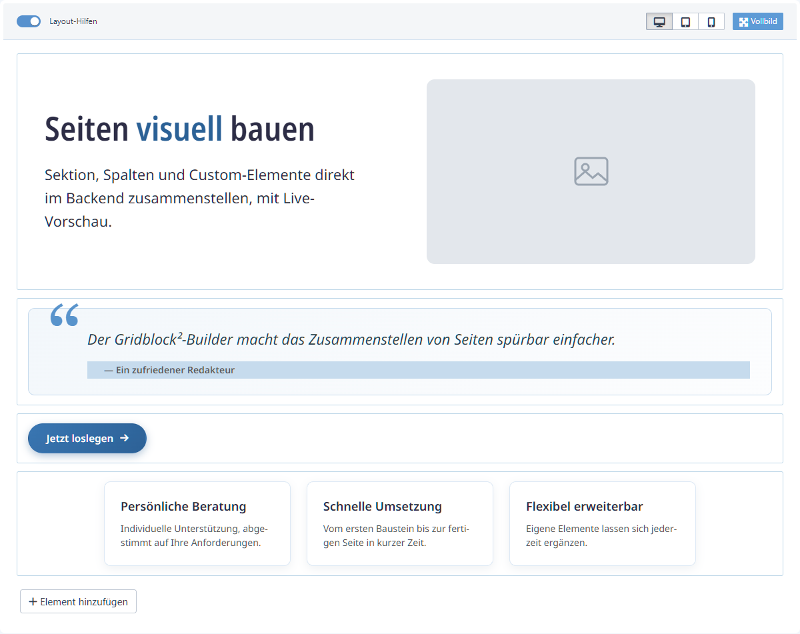
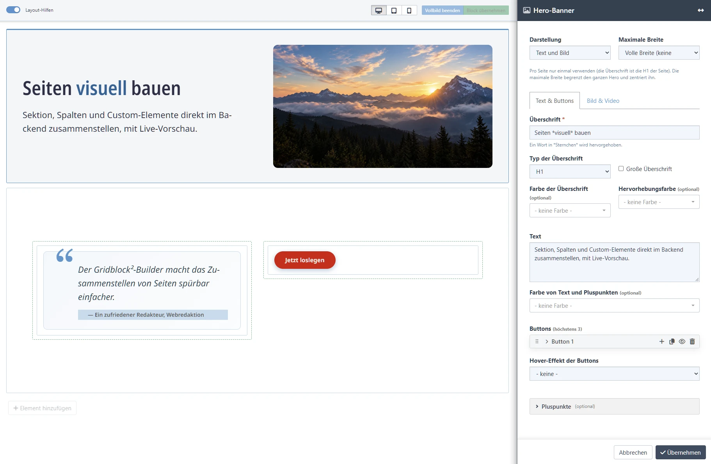
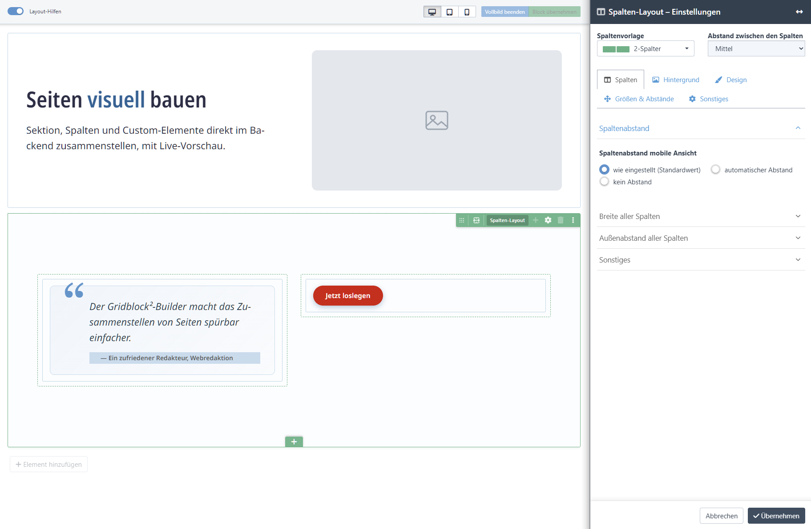

> [!WARNING]
> **BETA – noch nicht für den Produktiveinsatz geeignet!**

# Gridblock²

Page- bzw. Contentbuilder für Redaxo. 

Schluss mit starren Layouts und Spezialmodulen für jeden Spaltenwunsch: Mit Gridblock² baust du Seiten direkt im Backend visuell zusammen, per Drag & Drop, mit Live-Vorschau. Und das Beste: **Deine bestehenden REDAXO-Module funktionieren einfach weiter, ganz ohne Nachbauten.**

Gridblock² ist der Nachfolger von Gridblock 1.x und läuft parallel dazu, sodass sich bestehende Installationen in Ruhe migrieren lassen.

 

## Warum Gridblock²

- 🧩 **Echte Redaxo-Module, keine Nachbauten** - Text, Bild, Slider, eigene Module lassen sich 1:1 verwenden, kombiniert mit Sektion, Spalten und Custom-Elementen wie Hero-Banner, Call-to-Action, Karten, Zitat oder Formular.
- 🎨 **Visuell gestalten statt konfigurieren** - Layout direkt im Backend bauen, inklusive Live-Vorschau und Drag&Drop.
- 📐 **Frei definierbare Spaltenvorlagen** - eigene Aufteilungen und CSS-Klassen.
- 🧱 **Anpassung der Ausgabe an jedes Grid-System** (Bootstrap, UIKit, eigenes CSS-Grid) über die System-Elemente.
- 🎛️ **Contentsettings statt eigenem Modul-Code** - wiederkehrende Gestaltungsoptionen (Abstände, Hintergrund, ...) automatisch als Formular, für Sektion, Spalten-Zeile oder einzelne Spalte.
- 📦 **Import/Export & Synchronizer** - Spaltenvorlagen als ZIP mitnehmen, optional per Datei-Abgleich versionieren (beide optional, standardmäßig aus).
- 🔄 **Sanfte Migration von Gridblock 1.x** - bestehende Inhalte laufen unverändert weiter, bis sie im Builder neu gespeichert werden.
- 🌈 **Projektfarben-Palette** - Redakteure wählen Farben aus einer vom Projekt definierten Palette statt aus freien Farbfeldern.
- 🌐 **Multi-Site & Rechte** - je YRewrite-Domain eigene Vorschau-Werte und Element-Auswahl, Elemente zusätzlich je Rolle freigebbar.

 

## Screenshots

**Live-Vorschau im Builder** - Sektion, Spalten und Elemente direkt im Backend zusammenstellen.

**Element bearbeiten** - Das Bearbeiten-Fenster öffnet in einer Seitenleiste, die Vorschau bleibt daneben sichtbar.

**Contentsettings der Spalten-Zeile** - Layout, Hintergrund, Design, Größen und Abstände je Spalten-Zeile.

 

## Voraussetzungen

- REDAXO 5.20 oder neuer
- Optional, je nach genutzter Funktion: YRewrite (Multi-Site), YForm (Formular-Element), Vector Maps (Vector-Map-Element), VidStack (Videos im Hero), FA Iconpicker (Icon-Auswahl in CTA und Hero)

 

## Installation & erste Schritte

1. Addon über den Redaxo-Installer oder als ZIP einspielen und installieren.
2. Der **Einrichtungsassistent** (nur für Administratoren) startet direkt danach - je nachdem, ob eine bestehende Gridblock-1.x-Installation gefunden wird, für Ersteinrichtung oder Migration.
3. Unter **Spaltenvorlagen** ein paar mitgelieferte Beispiele installieren oder eigene anlegen.
4. Im Artikel das Modul **„01 - Gridblock (Pagebuilder & Blöcke gruppieren)“** einfügen und über "Hinzufügen" loslegen.

Alle Details - Contentsettings, Vorschau-Technik, Import/Export, Synchronizer, Migration und mehr - stehen ausführlich und durchsuchbar in der **Onlinehilfe** des Addons im Redaxo-Backend.

 

## Was sich gegenüber Gridblock 1.x ändert

- ✅ Sektion & Spalten baust du direkt visuell im Artikel - eine Spaltenvorlage ist nur noch für die Aufteilung nötig, nicht mehr für den ganzen Baustein.
- ✅ Contentsettings kennen jetzt auch einen eigenen Scope für die Sektion, neben der Spalten-Zeile und der einzelnen Spalte.
- ✅ Live-Vorschau direkt im Builder (iframe oder Shadow-DOM), nicht mehr nur im Frontend sichtbar.
- ✅ Import/Export und Synchronizer sind fest eingebaut - kein separates Plugin mehr nötig.
- ⚠️ Eigener PHP-Ausgabecode pro Spaltenvorlage entfällt - neue Vorlagen brauchen keinen mehr, die Ausgabe übernehmen die neuen Gridblock²-Systemelemente selbst.
- ⚠️ Eine Spaltenvorlage lässt sich nicht mehr eigenständig als fertiger Baustein einsetzen.

Bestehende Gridblock-1.x-Inhalte laufen davon unberührt weiter, bis sie im Builder einmal neu gespeichert werden - alle Details dazu in der **Onlinehilfe**.

 

## Changelog

Siehe [CHANGELOG.md](CHANGELOG.md).

## Fragen, Wünsche, Probleme?

Issue anlegen unter [github.com/iceman-fx/gridblock2](https://github.com/iceman-fx/gridblock2).

## Credits

Ursprüngliche Contentsettings/Synchronizer-Idee: [Daniel Steffen](https://github.com/novinet-git)  
Ursprüngliche Gridblock-Idee: [Marcel Kuhmann](https://github.com/bloep)

## Lizenz

MIT-Lizenz, siehe [LICENSE](LICENSE).
